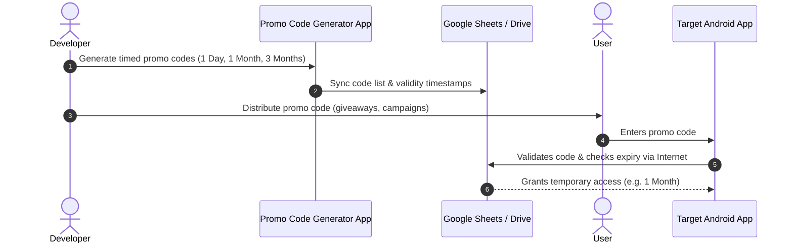

# 🎟️ Promo Code Generator & Manager

> A lightweight, serverless solution for mobile developers to generate, distribute, and manage time-limited promotional access (1 Day, 1 Month, 3 Months, etc.) using their own Google Drive & Google Sheets backend.

---

## 📌 Project Status

⚠️ **Work in Progress (Under Active Development)**  
This project is currently being developed. Once the core build and testing are finalized, complete documentation, setup guides, and drop-in client code snippets will be released here.

---

## 💡 The Problem with Google Play Console Promo Codes

When promoting Android apps via the Google Play Console:
- One-time promo codes generally grant **permanent / lifetime access** to in-app items or purchases.
- Running flexible promotional giveaways with strict temporary trial periods (such as **1 Day, 1 Month, or 3 Months**) without locking users into recurring Play Store subscriptions or permanently giving away premium tiers is either limited or challenging to configure.
- Small developers and indie creators often don't want the cost or complexity of running dedicated authentication and subscription servers just to run seasonal promotional campaigns and giveaways.

---

## ✨ The Solution

**Promo Code Generator** provides a 100% legal, flexible, and zero-server-cost solution for app creators:

- ⏳ **Custom Timed Giveaways**: Offer promotional access for **1 Day**, **1 Month**, **3 Months**, or any custom duration you define.
- 📂 **Serverless & Free**: Powered directly by your own **Google Drive** and **Google Sheets** to store, track, and validate promo codes securely.
- 🛡️ **Clean & Legal Integration**: Integrates directly with your app's logic without violating store policies.
- 🌐 **Real-Time Validation**: Utilizes active internet connectivity to verify code validity, track redemption, and enforce expiration timestamps dynamically.

---

## ⚙️ Requirements & Prerequisites

To use this solution in your own app:
1. **Active Internet Connection**: The target client app requires network access (`android.permission.INTERNET`) to validate promo codes against the cloud backend.
2. **Google Drive / Google Sheets Setup**: Used as the database to store issued codes, validity windows, and activation statuses.
3. **Client SDK / Codebase**: A lightweight helper class/snippet (to be provided in this repository once the build is finalized) that you copy-paste into your project.

---

## 🚀 How It Works

---

## 📦 What's Coming Next?

- [ ] Complete drop-in client codebase & integration snippet.
- [ ] Step-by-step Google Sheets & Google Drive template setup guide.
- [ ] Device binding & anti-abuse prevention guidelines.
- [ ] Pre-built APK releases for testing.

---

## 📄 License

This project is licensed under the [MIT License](LICENSE) (or your preferred license).
